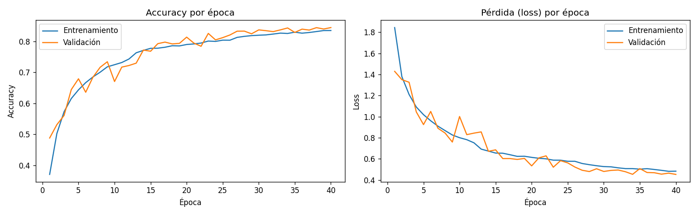
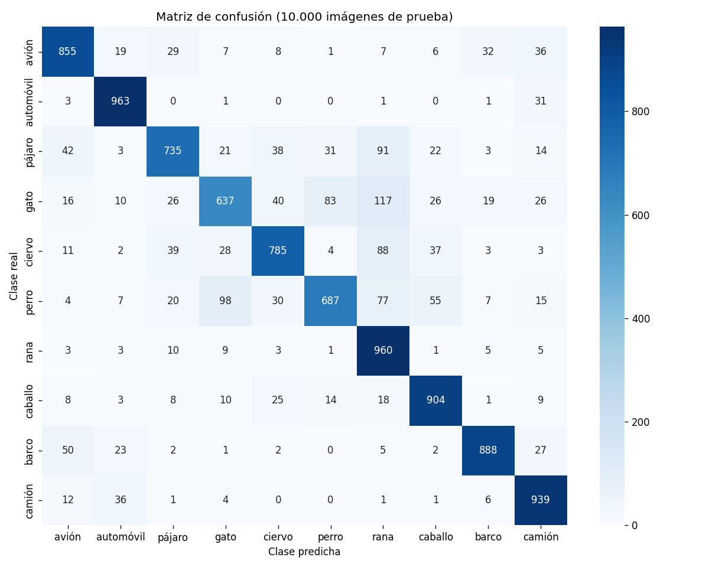
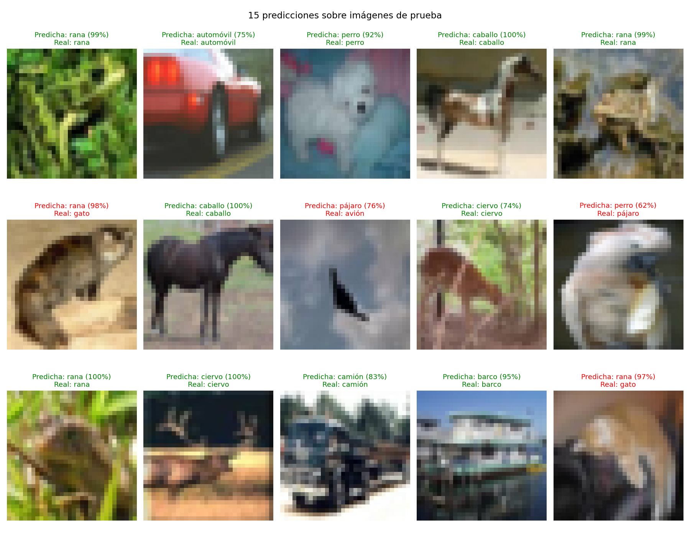

# Clasificador de imágenes con CNN (CIFAR-10)

Red Neuronal Convolucional entrenada en Google Colab para clasificar imágenes en 10 clases: avión, automóvil, pájaro, gato, ciervo, perro, rana, caballo, barco y camión. Incluye una aplicación en Streamlit que carga el modelo entrenado y predice la clase de una imagen subida por el usuario, con su nivel de confianza.

## Dataset

**CIFAR-10** (Krizhevsky, Nair y Hinton, Universidad de Toronto, 2009). 60.000 imágenes a color de 32x32 píxeles, 6.000 por clase. Viene incluido en Keras y se descarga solo al correr el notebook, por eso no está dentro del repositorio.

| Conjunto | Imágenes |
|---|---|
| Entrenamiento | 45.000 |
| Validación | 5.000 (10% del entrenamiento original, estratificado) |
| Prueba | 10.000 |

## Estructura del repositorio

```
cnn-cifar10/
├── notebooks/
│   └── cnn_cifar10.ipynb    # Experimentación completa (Colab)
├── src/
│   ├── train.py             # Entrenamiento en script
│   └── predict.py           # Predicción de una imagen
├── models/
│   ├── cnn_cifar10.keras    # Modelo entrenado
│   └── clases.json          # Nombre de cada clase
├── reports/                 # Gráficas y métricas generadas
├── app.py                   # Aplicación Streamlit
├── requirements.txt
└── README.md
```

## Resultados

| Métrica | Valor |
|---|---|
| Accuracy en prueba | [completar] |
| Pérdida en prueba | [completar] |
| Épocas entrenadas | [completar] |
| Mejor clase (F1) | [completar] |
| Peor clase (F1) | [completar] |





## Cómo ejecutarlo

### 1. Entrenar en Google Colab

1. Abre `notebooks/cnn_cifar10.ipynb` en Colab.
2. Activa la GPU: **Entorno de ejecución → Cambiar tipo de entorno de ejecución → T4 GPU**.
3. Ejecuta todas las celdas (**Entorno de ejecución → Ejecutar todas**).
4. La última celda de guardado descarga `resultados_cnn.zip`. Descomprímelo y copia su contenido a las carpetas `models/` y `reports/` del repositorio.
5. En Colab: **Archivo → Descargar → Descargar .ipynb** y reemplaza `notebooks/cnn_cifar10.ipynb` con esa versión, que ya trae las salidas y las gráficas.

### 2. Instalar el entorno local

Requiere Python 3.10 a 3.13.

```bash
git clone <url-del-repositorio>
cd cnn-cifar10
python -m venv .venv

# Windows
.venv\Scripts\activate
# Linux / macOS
source .venv/bin/activate

pip install -r requirements.txt
```

Si al abrir el modelo aparece un error de versión, instala la misma versión de TensorFlow que usó Colab (la imprime la primera celda del notebook), por ejemplo `pip install tensorflow==2.19.0`.

### 3. Ejecutar la aplicación Streamlit

```bash
streamlit run app.py
```

Se abre en el navegador en `http://localhost:8501`. Sube una imagen JPG o PNG y la aplicación muestra la clase predicha, la confianza y la probabilidad de cada una de las 10 clases.

### 4. Usar los scripts (opcional)

Entrenar sin el notebook. Deja el modelo en `models/` y las gráficas en `reports/`. Sin GPU tarda mucho más.

```bash
python src/train.py
python src/train.py --epocas 20 --batch 128
```

Predecir una imagen desde la terminal:

```bash
python src/predict.py ruta/a/imagen.jpg
```

## Detalles del modelo

- **Preprocesamiento:** píxeles divididos entre 255 (rango 0 a 1). Las imágenes nuevas se redimensionan a 32x32 antes de predecir.
- **Data Augmentation:** volteo horizontal, rotación de ±5%, zoom de 10% y desplazamiento de 10%. Solo actúa durante el entrenamiento.
- **Arquitectura:** 3 bloques convolucionales (32, 64 y 128 filtros) con BatchNormalization, MaxPooling y Dropout, seguidos de una capa densa de 128 neuronas y una salida softmax de 10 clases.
- **Entrenamiento:** Adam (tasa 0.001), hasta 40 épocas con EarlyStopping (paciencia 6) y ReduceLROnPlateau.
- **Evaluación:** accuracy, precision, recall y F1 por clase, y matriz de confusión sobre las 10.000 imágenes de prueba.

## Limitaciones

El modelo solo conoce 10 clases. Si recibe la foto de algo distinto, como una persona o una flor, igual elige una de las 10. Además aprendió con imágenes de 32x32, así que rinde mejor cuando el objeto ocupa casi toda la foto.
